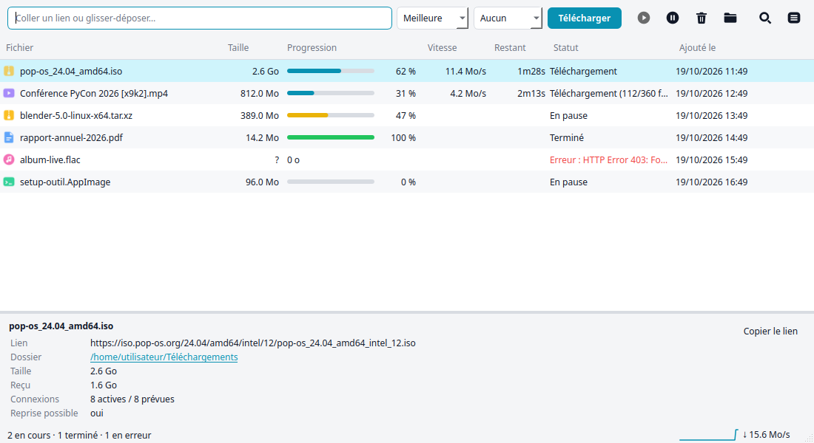

# PyDM — gestionnaire de téléchargement pour Linux (style IDM)

🇬🇧 [Read in English](README.md)



## 1. Installer PyDM

Il faut Python 3.9 ou plus récent avec le module `venv`, et une connexion Internet
pendant l'installation (PySide6 et yt-dlp sont téléchargés).

```bash
sudo apt install python3-venv ffmpeg      # Fedora : sudo dnf install ffmpeg
git clone https://github.com/BenKL404/pydm.git && cd pydm
./install.sh
```

`install.sh` crée un environnement Python privé (`~/.local/share/pydm/venv`) avec
PySide6 et yt-dlp, installe PyDM à côté, ajoute la commande `pydm`
et l'entrée dans le menu des applications. Il déclare aussi PyDM auprès de
Firefox, Chrome, Chromium, Brave, Edge, Vivaldi et Opera. Si vous installez un
navigateur plus tard, relancez simplement `./install.sh`.

## 2. Installer l'extension

### Chrome, Chromium, Brave, Edge, Vivaldi, Opera
1. Ouvrez `chrome://extensions` (ou `brave://extensions`, `edge://extensions`…).
2. Activez le **Mode développeur** (en haut à droite).
3. Cliquez sur **Charger l'extension non empaquetée** et choisissez le dossier `extension/`.
4. Redémarrez le navigateur.

Laissez le dossier `extension/` à sa place : le navigateur le lit à chaque démarrage.

### Firefox
- **Recommandé** : téléchargez `pydm-extension-1.0.0-signee.xpi` depuis la
  [dernière version](https://github.com/BenKL404/pydm/releases/latest), puis dans
  `about:addons` → ⚙ → *Installer un module depuis un fichier*. Elle est signée par
  Mozilla et reste installée.

Autres possibilités (Firefox n'installe de façon permanente que les extensions signées) :

- **Pour essayer** : ouvrez `about:debugging#/runtime/this-firefox`, cliquez sur
  **Charger un module complémentaire temporaire** et choisissez `pydm-extension.zip`.
  L'extension disparaît quand Firefox se ferme.
- **Firefox Developer Edition / Nightly / ESR** : dans `about:config`, mettez
  `xpinstall.signatures.required` à `false`, puis ouvrez `pydm-extension.zip`
  dans `about:addons` → ⚙ → *Installer un module depuis un fichier*.
- **Firefox normal, de façon permanente** : faites signer l'extension
  gratuitement en distribution privée (« unlisted ») :
  `npx web-ext sign --channel=unlisted --api-key=… --api-secret=…`
  (clés gratuites sur addons.mozilla.org → Outils de développement).

Les navigateurs installés en **Flatpak** ne peuvent pas lancer PyDM : utilisez la
version `.deb` ou `.rpm` du navigateur. Firefox en Snap (Ubuntu) fonctionne.

## 3. Utilisation (comme IDM)

| Action | Résultat |
|---|---|
| Cliquer sur un lien de téléchargement | Le navigateur s'efface et PyDM télécharge avec 8 connexions |
| Ouvrir une page vidéo (YouTube…) | PyDM prépare la vidéo en arrière-plan : au clic, la liste des qualités est déjà prête (désactivable dans le popup ; seulement si PyDM est ouvert) |
| Survoler une vidéo | Un bouton **⬇ Télécharger cette vidéo** apparaît en haut à droite du lecteur |
| Clic droit sur un lien / une vidéo / une page | **Télécharger avec PyDM** |
| Icône PyDM de la barre d'outils | État de la connexion, médias détectés sur la page (le chiffre sur l'icône), réglages |

- Les cookies et la page d'origine sont transmis à PyDM : les téléchargements
  qui demandent d'être connecté fonctionnent.
- Les fichiers de moins de 100 Ko restent au navigateur.
- Si PyDM n'est pas joignable, le navigateur télécharge normalement (point rouge sur l'icône).
- PyDM s'ouvre tout seul s'il est fermé.

## 4. L'interface

- **Avant chaque téléchargement**, une fenêtre montre ce qui va être téléchargé :
  pour une vidéo, la miniature, le titre, la durée et le menu **Qualité** avec les
  qualités réellement disponibles et leur taille (1080p, 720p…, Audio seul MP3) ;
  pour un fichier, sa taille, son type et si la reprise est possible. On peut changer
  le nom et le dossier, puis **Télécharger**, **Plus tard** (ajouté en pause) ou
  **Annuler**. Plusieurs liens d'un coup ouvrent une seule fenêtre, avec une case par
  lien. « Ne plus demander » revient au téléchargement direct (à réactiver dans les
  préférences).
- **Fenêtre de progression, comme IDM** : elle s'ouvre au démarrage de chaque
  téléchargement ajouté (désactivable dans les préférences) ou par double-clic /
  clic droit → Progression… Elle montre la vitesse, le temps restant, la **carte des
  connexions** (chaque segment du fichier à sa place, coloré au fur et à mesure) et le
  détail de chaque connexion ; Pause / Reprendre, Annuler, « Fermer à la fin ».
- **Rangement par type, comme IDM** : chaque fichier va dans un sous-dossier de
  `~/Téléchargements` selon son type — `Vidéos`, `Musique` (dont l'audio MP3 extrait
  d'une vidéo), `Documents`, `Images`, `Archives`, `Programmes` ; le reste reste à la
  racine. Les sous-dossiers sont créés au premier fichier. Dans les préférences, on
  peut désactiver le rangement ou changer chaque dossier (un nom de sous-dossier, ou
  un chemin complet comme `/media/disque/Films`).
- **Barre latérale** (Ctrl+B pour l'afficher ou la masquer) : filtre la liste par
  **état** (En cours, En file, En pause, Terminés, En erreur) et par **type** (Vidéos,
  Musique, Documents, Images, Archives, Programmes, Autres), les deux se combinent avec
  la recherche ; un compteur suit chaque entrée. Clic droit sur un type → ouvrir son
  dossier de rangement.
- **Coller un lien** dans le champ du haut (ou n'importe où avec Ctrl+V), ou le
  **glisser-déposer** sur la fenêtre ; plusieurs liens à la fois sont acceptés.
- Les menus **Qualité** et **Cookies** s'appliquent aux vidéos de streaming.
- **Clic droit** sur une ligne : reprendre, pause, ouvrir le fichier ou le dossier,
  copier le lien, retirer de la liste, supprimer le fichier.
- **Raccourcis** : Espace (pause / reprise), Suppr (retirer), Ctrl+F (rechercher),
  Ctrl+O (dossier), Ctrl+, (préférences), Ctrl+Q (quitter).
- Le **panneau du bas** détaille le téléchargement sélectionné ; double-clic pour le
  masquer, ou pour ouvrir un fichier terminé.
- **Fermer la fenêtre** laisse PyDM dans la barre système (désactivable dans les
  préférences) ; une notification signale chaque téléchargement terminé ou en échec.
- **Préférences** (menu ☰) : dossier, connexions, thème clair / sombre / système,
  fenêtre d'ajout, presse-papiers, notifications, démarrage avec la session.
- Pour les vidéos, PyDM essaie d'abord **sans vos cookies** (YouTube refuse souvent
  une session connectée), puis avec, seulement si c'est nécessaire.

## 5. File d'attente et planification

- **Télécharger** démarre tout de suite, dans la limite des téléchargements
  simultanés (3 par défaut) : au-delà, la ligne affiche « En file » et part dès
  qu'une place se libère. **Plus tard** met dans la **file planifiée**.
- La file planifiée démarre pendant la **plage horaire** (par exemple 01:00–07:00)
  ou avec ⏱ → **Démarrer la file** ; à la fin de la plage, ses téléchargements se
  mettent en pause et reprennent la nuit suivante.
- **Forcer** (⏩ ou clic droit) démarre immédiatement, sans limite ni plage.
- Clic droit → **Monter / Descendre / En tête de file** (Ctrl+↑, Ctrl+↓,
  Ctrl+Origine) : l'ordre de la liste est l'ordre de la file.
- **Limite de vitesse** : le bouton « Limite … Mo/s » de la barre d'état l'active
  ou la désactive d'un clic ; elle s'applique aussitôt à tous les téléchargements.
- ⏱ → **Planification…** : simultanés, limite, plage horaire et action quand la file
  est terminée (rien, quitter PyDM, mise en veille, extinction, avec 60 s pour
  annuler).
- Limite connue : quand yt-dlp passe la main à ffmpeg (certains flux en direct),
  la limite de vitesse ne s'applique pas.

## Limites
- Les vidéos protégées par DRM (Netflix, Disney+, Prime Video, Spotify…) ne
  peuvent pas être téléchargées.
- Les téléchargements produits par un formulaire (POST) sont redemandés par
  simple lien et peuvent échouer. Désactivez alors l'interception dans l'icône PyDM.
- Mettez yt-dlp à jour régulièrement en relançant `./install.sh` : les sites changent souvent.

## Contribuer

Signalements de bugs, idées et pull requests sont les bienvenus, en français ou en
anglais : voir [CONTRIBUTING.md](CONTRIBUTING.md) et le [code de conduite](CODE_OF_CONDUCT.md).
Pour une faille de sécurité, suivez [SECURITY.md](SECURITY.md) (jamais d'issue publique).

## Licence

PyDM est un logiciel libre distribué sous licence
[GNU GPL version 3 ou ultérieure](LICENSE).
