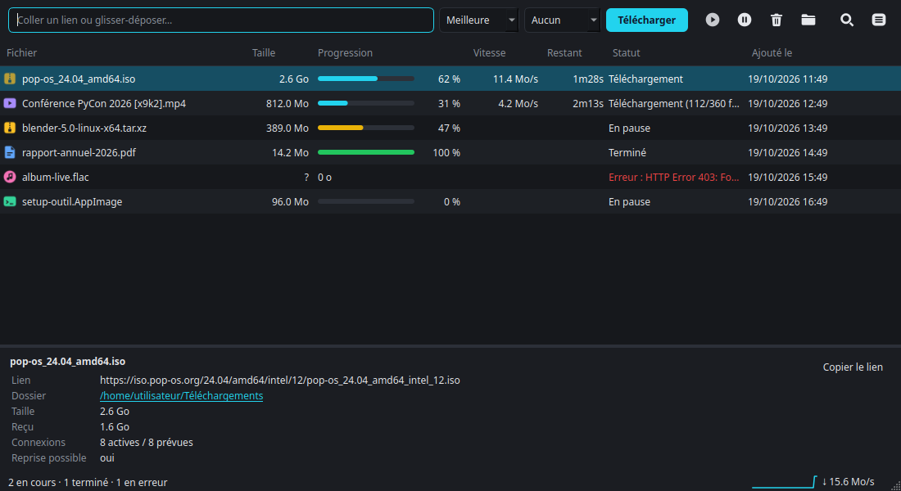

# PyDM

**A multi-connection download manager for Linux, in the spirit of Internet Download Manager (IDM).**

[](https://github.com/BenKL404/pydm/actions/workflows/ci.yml)
[](LICENSE)

🇫🇷 [Lire en français](LISEZMOI.md)

PyDM splits each download into several parallel connections, resumes after a
pause or a crash, and plugs into your browser: click a download link or hover
over a video, and PyDM takes over.



## Features

- **Up to 32 parallel connections per file**, with dynamic splitting: a free
  connection takes over half of the largest remaining segment.
- **Pause and resume**, even after closing PyDM or rebooting.
- **Automatic retries** when the network drops.
- **Streaming videos** (YouTube, Vimeo, Twitch, Dailymotion, TikTok, HLS/DASH
  streams…) through [yt-dlp](https://github.com/yt-dlp/yt-dlp), with quality
  selection and MP3 extraction.
- **Browser integration** for Firefox, Chrome, Chromium, Brave, Edge, Vivaldi
  and Opera: download interception, a "Download this video" button on players,
  a context menu entry, and cookies and referrer forwarding so downloads that
  require a login work.
- **A modern, dense interface** (Qt 6): real progress bars, light and dark
  themes that follow the system, sortable columns, search, a detail panel,
  right-click menu, keyboard shortcuts and drag-and-drop of links.
- **Runs in the background** from the system tray, with a notification when a
  download finishes or fails, and an option to start with the session.
- **Clipboard monitoring**: copy a link and PyDM picks it up.
- **Light footprint**: the download engine and the command line use only the
  Python standard library; the interface uses PySide6, installed automatically
  in a private environment.

The interface is in French.

## Requirements

- Linux
- Python 3.9 or newer with the `venv` module (`python3-venv` on Debian/Ubuntu)
- An Internet connection during installation (PySide6 and yt-dlp are downloaded)
- Optional: [ffmpeg](https://ffmpeg.org/) for best video quality and MP3

## Installation

```bash
sudo apt install python3-venv ffmpeg      # Fedora: sudo dnf install ffmpeg
git clone https://github.com/BenKL404/pydm.git
cd pydm
./install.sh
```

`install.sh` creates a private Python environment in `~/.local/share/pydm/venv`
with PySide6 and yt-dlp, installs PyDM next to it, adds the `pydm` command
and a menu entry, and registers PyDM with every supported browser it finds. Run
it again after installing a new browser, or to update PyDM, PySide6 and yt-dlp.

### Browser extension

**Chrome, Chromium, Brave, Edge, Vivaldi, Opera**

1. Open `chrome://extensions` (or `brave://extensions`, `edge://extensions`…).
2. Enable **Developer mode**.
3. Click **Load unpacked** and select the `extension/` folder.
4. Restart the browser.

Keep the `extension/` folder where it is: the browser reads it at every start.

**Firefox**

Firefox only installs Mozilla-signed extensions permanently:

- **To try it out**: open `about:debugging#/runtime/this-firefox`, click
  **Load Temporary Add-on** and choose `pydm-extension.zip`. It is removed when
  Firefox closes.
- **Developer Edition / Nightly / ESR**: set `xpinstall.signatures.required` to
  `false` in `about:config`, then install `pydm-extension.zip` from
  `about:addons` → ⚙ → *Install Add-on From File*.
- **Regular Firefox, permanently**: sign it for free as an unlisted add-on:
  `npx web-ext sign --channel=unlisted --api-key=… --api-secret=…`
  (free keys at addons.mozilla.org → Developer Hub).

Browsers installed as **Flatpak** cannot launch PyDM; use the `.deb`/`.rpm`
build of the browser. Snap Firefox (Ubuntu) works.

## Usage

```bash
pydm                                   # graphical interface
pydm URL [-o FOLDER] [-n CONNECTIONS] [-q QUALITY] [--cookies BROWSER]
```

| Action | Result |
|---|---|
| Click a download link | The browser steps aside and PyDM downloads with 8 connections |
| Hover over a video | A **⬇ Télécharger cette vidéo** button appears on the player |
| Right-click a link, a video or a page | **Télécharger avec PyDM** |
| PyDM toolbar icon | Connection status, media detected on the page, settings |

Files smaller than 100 KB are left to the browser. If PyDM cannot be reached,
the browser downloads normally. PyDM starts automatically if it is closed.

## How it works

```
extension/ (browser)  --native messaging-->  pydm_host.py  --Unix socket-->  pydm (app)
```

The extension sends each download to `pydm_host.py`, which the browser starts
through native messaging. The host forwards it to the running PyDM instance
over a private Unix socket (`~/.config/pydm/pydm.sock`), launching PyDM first
if needed.

## Limitations

- DRM-protected videos (Netflix, Disney+, Prime Video, Spotify…) cannot be downloaded.
- Downloads produced by a form (POST) are re-requested as a plain link and may
  fail. Turn interception off from the PyDM icon in that case.
- Keep yt-dlp up to date by running `./install.sh` again: sites change often.

## Contributing

Bug reports, ideas and pull requests are welcome. See
[CONTRIBUTING.md](CONTRIBUTING.md) and the [Code of Conduct](CODE_OF_CONDUCT.md).
To report a security issue, follow [SECURITY.md](SECURITY.md).

## License

PyDM is free software, released under the
[GNU General Public License v3.0 or later](LICENSE).
